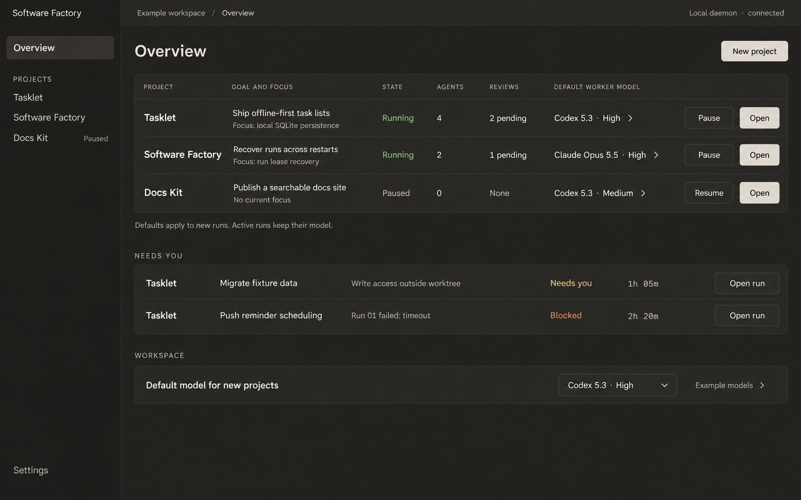

# Software Factory

A quiet place to steer persistent software-building agents.

One main agent holds a project's goal, delegates bounded work, verifies results and brings back reviewable changes. A Rust service owns persistent state; terminal and desktop clients share its conversation and progress views.

Status: architecture and visual design, not yet a runnable application. The repository was empty at the start of this project. Claude through the Cursor CLI produced the current redesign: Conversation, Progress and Reviews are separate destinations, and the latest Soft Charcoal pass preserves the workspace overview, project-scoped tabs and model pickers while softening the dark surfaces and adding run details. The visual direction is awaiting selection before implementation.

- [Getting started and implementation milestones](docs/getting-started.md)
- [Architecture and shared contract](docs/architecture.md)
- [Harness, recovery and experiments](docs/harness.md)
- [Provider protocols and verified local probes](docs/providers.md)
- [Release acceptance](docs/acceptance.md)
- [Research and sources](docs/research.md)
- [Revised visual direction](docs/design/README.md)

The intended stack is Rust, SQLite, Axum, Ratatui and Tauri. Codex app-server is the first execution integration. Other providers and deployment connections must report observed capability rather than simulated activity.

## Current design proposal

[Workspace overview](docs/design/soft-charcoal/overview.png) · [Conversation](docs/design/soft-charcoal/conversation.png) · [Progress / Sundial radar](docs/design/soft-charcoal/progress.png) · [Reviews](docs/design/soft-charcoal/reviews.png) · [Run detail](docs/design/soft-charcoal/run-detail.png)

## Reusable design skills

The [UI/UX design suite](design-skills/README.md) provides seven focused skills plus checks for contrast, layout budgets and interaction handoffs. Start with `ui-ux-designer`; the soft-charcoal operating style is an optional project profile.
