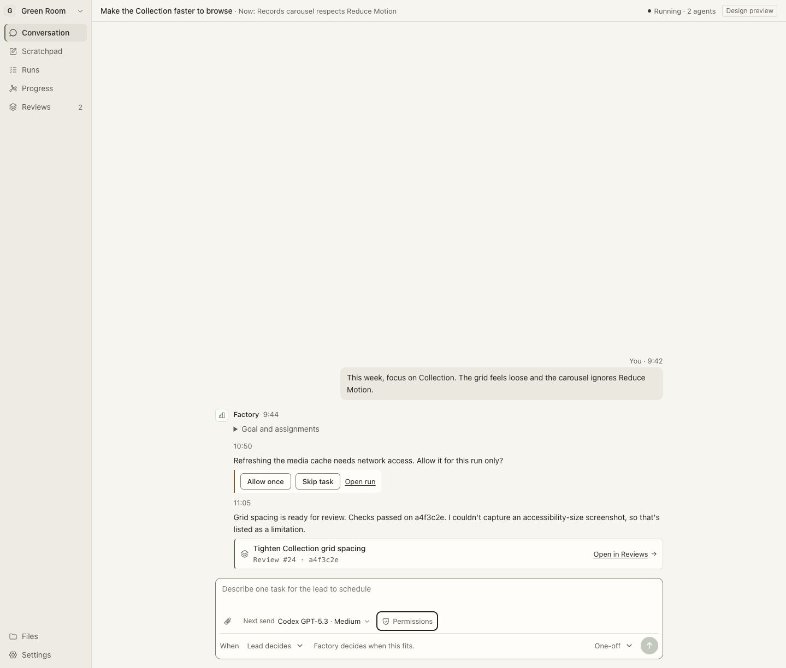

# Software Factory

A compact local workspace for steering one lead agent, monitoring delegated work, and reviewing exact-revision changes.

The local alpha now has a Rust/SQLite core, independent authenticated `factoryd` daemon, Codex app-server integration, isolated Git worktrees, supervisor-observed checks, and a Tauri desktop client over the approved React interface. One project and one bounded worker are supported. The [runtime checkpoint](docs/runtime/IMPLEMENTATION.md) records verification and acceptance status; implementation and metadata probes alone do not establish a successful real workflow.

Start with [START-HERE](START-HERE.md), then follow [getting started](docs/getting-started.md) to build and launch the native app. Use existing supported Codex authentication. The daemon owns execution on an awake host; closing the client does not stop it. Model turns use the configured account and can incur usage.

In native mode, register a repository and objective, save a supported model and project permissions, then send steering or a **One-off** from the bottom of Conversation. Requests remain intent until the lead plans a Task and the supervisor starts a Run. Inspect active work in Graph, Board or Sundial, and open the separate Reviews desk for actual diff, checks, source SHA and local feedback. Command approval is scoped to an attempt and its checks. Network and integrations are disabled for alpha execution.

The browser-only Vite app remains a [design preview](docs/design/compact-preview/README.md), with fixture activity and browser-local simulations. It needs no provider credentials and cannot run agents. The native app never falls back to those fixtures. Scratchpad remains a blank client-local document with its configurable morning plan in Settings; recurring agent triage is later work.

[Connect GitHub or GitLab](docs/integrations.md) in native **Settings → Integrations** using existing `gh` or `glab` authentication. **Reviews → Repository** reads open pull/merge requests and selected-request CI separately from local review evidence. These human-requested reads do not change agent permission ceilings.

The alpha does not push, create or merge PRs, deploy, or install recurring jobs. Additional providers, TUI parity and hosted continuity are later milestones. Legacy provider sandbox controls restrict writes and networking but permit host reads; worktrees are not credential isolation. Output-token limits are observed thresholds rather than hard prepaid spend caps.

- [Active goal](docs/runtime/GOAL.md), [agent prompt](docs/handoff/AGENT-PROMPT.md), and [build plan](docs/handoff/BUILD-PLAN.md)
- [All mocks, references and current screens](docs/handoff/DESIGN-INDEX.md)
- [Native bridge and service boundary](apps/desktop/src-tauri/README.md)
- [Repository integration setup and CI limits](docs/integrations.md)
- [Architecture](docs/architecture.md), [harness](docs/harness.md), [providers](docs/providers.md), and [broader acceptance](docs/acceptance.md)

The local alpha is committed and pushed on `main` at `8e3fbd7`; a current clone includes its runtime and design source. The original frozen handoff's manifest records an earlier base that omitted those files. Preserve that historical manifest when comparing snapshots. The subsequent repository-integration changes have their own verification status in the checkpoint.

## Additional design resources

The remote history also includes [Soft Charcoal](docs/design/soft-charcoal/README.md), [Charcoal Desk](docs/design/charcoal-desk/README.md) and [Operating Desk](docs/design/operating-desk/README.md) visual explorations. They remain available for comparison; the implemented native alpha follows the current compact-preview contracts.

The [reusable UI/UX design suite](design-skills/README.md) provides seven focused skills plus checks for contrast, layout budgets and interaction handoffs. Its optional soft-charcoal profile does not replace the approved application design.
