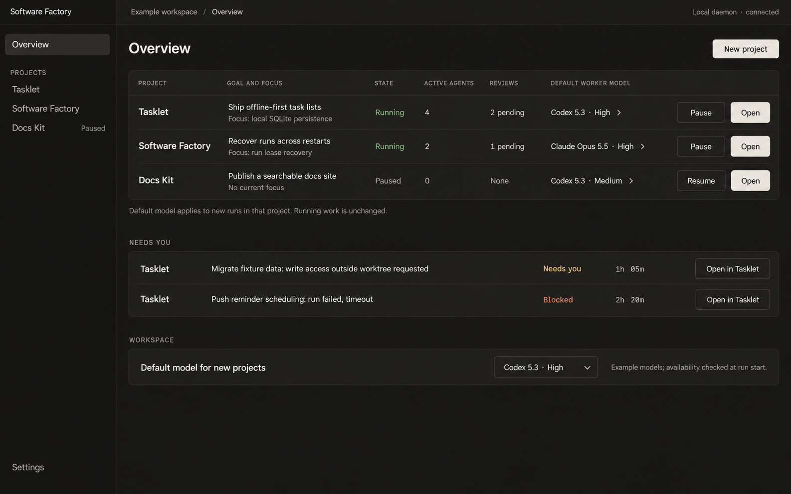
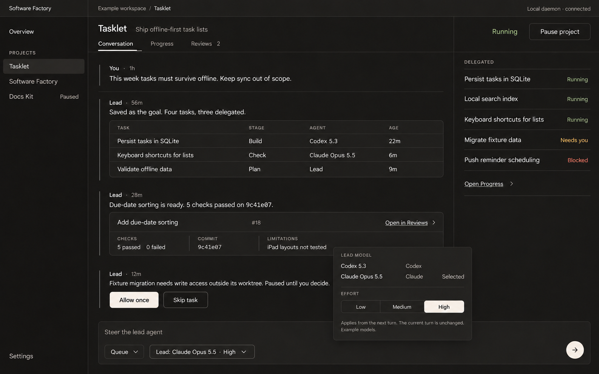
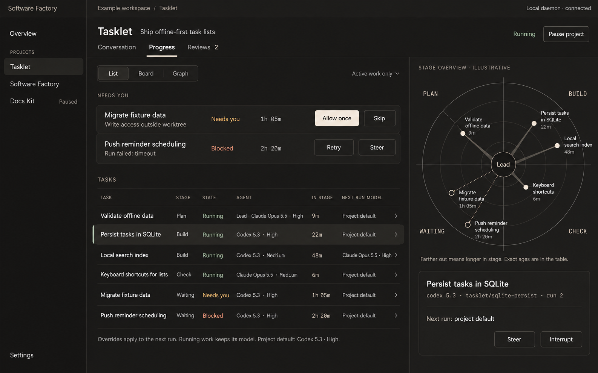
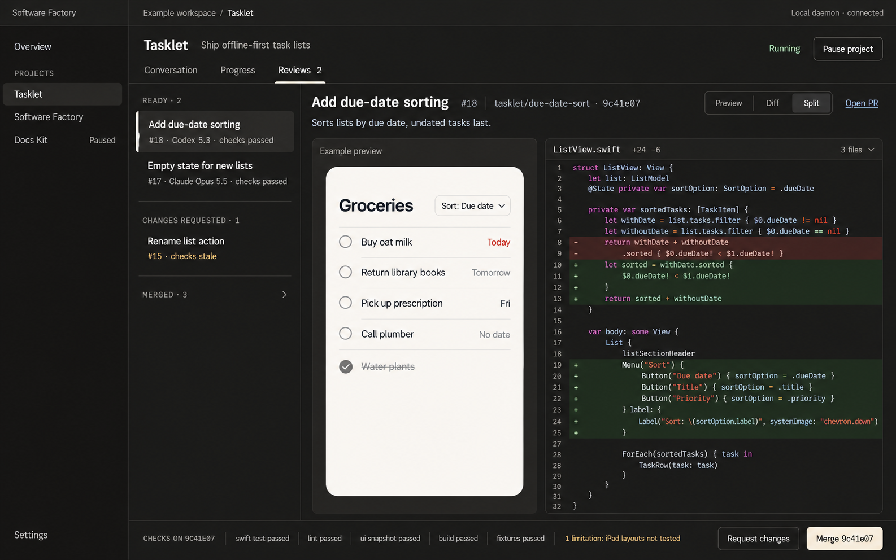

# Charcoal Desk

Proposed November 1, 2026. Designed by Claude Opus through Cursor CLI, rendered with built-in Image Gen. These are illustrative mockups, not a running application.

The latest user direction is a compact charcoal operations dashboard, no emoji, explicit model pickers and control across projects. Each project owns its Conversation, Progress and Reviews.

## Hierarchy

- Workspace Overview lists projects, goals, active work, pending reviews and items requiring attention. Every action names its project.
- Selecting a project opens its own Conversation / Progress / Reviews tabs. The sidebar remains a project switcher rather than a global conversation or review queue.
- Conversation steers one lead agent for the selected project. Progress inspects that project's tasks. Reviews inspects that project's changes and evidence.

## Model selection

| Control | Scope | Takes effect |
| --- | --- | --- |
| Workspace default | New projects | At project creation |
| Project default worker model | New runs in that project without an override | Next run |
| Lead model and effort | Selected project's lead conversation | Next turn |
| Task override | Selected task | Next run |

Existing turns/runs retain their effective model. Provider, model and effort are visible; example model names are not claims of verified availability. Implementation must populate choices from observed provider capabilities and expose unsupported or unavailable choices honestly.

## Screens

### Workspace overview

### Project conversation and model picker

### Project progress

### Project reviews

## Sources

- [Claude design brief](claude-design-brief.md)
- [Request](request.md) and [execution provenance](provenance.json)
- Rendering prompts: [Overview](overview-prompt.txt), [Conversation](conversation-prompt.txt), [Progress](progress-prompt.txt), [Reviews](reviews-prompt.txt)
- [Earlier Operating Desk proposal](../operating-desk/README.md)

The rendering prompts remove the brief's colored window controls and selection checkmark, reinforce text-only navigation, and preserve the requested charcoal surfaces. The Sundial is an illustrative stage view; exact ages belong to the table. Raster text, sizing and geometry must be verified during implementation.
