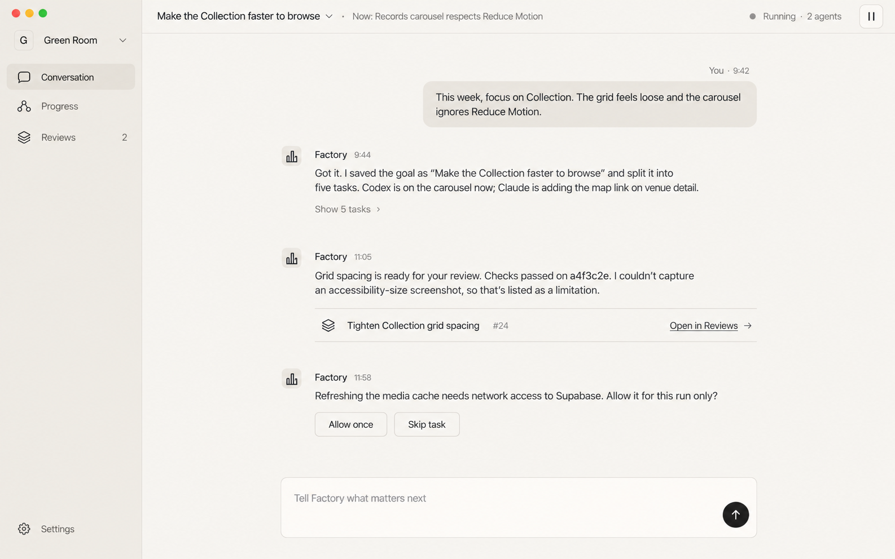
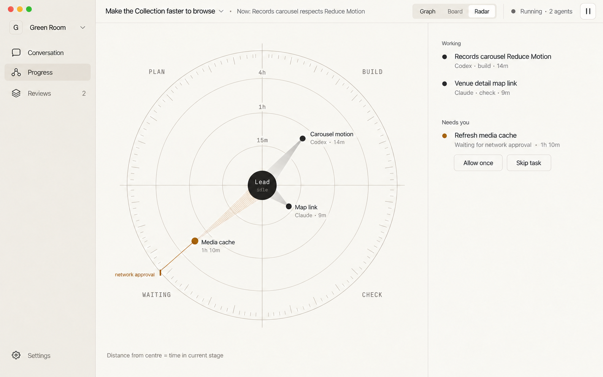
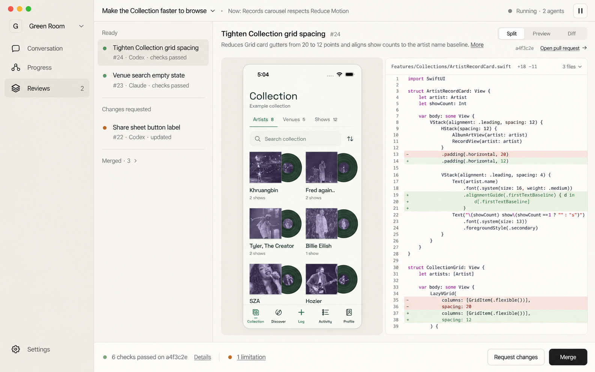

# Claude redesign

November 1, 2026. Current design proposal, awaiting visual selection. These are design mocks, not a running factory, real pull requests or observed test/deployment results.

Claude Opus 5.5 through the installed Cursor CLI authored the direction after inspecting the three previous mockups, the Codex reference and the factory reference. The same Claude session then refined Radar to exclude changes entirely. Both calls returned a successful terminal result and exited zero. Images were rendered with the built-in Image Gen tool from Claude's prompts; they are not images generated by Cursor itself.

## Hierarchy

- **Conversation:** talk to one lead agent. Worker details remain on disclosure. A result can link to Reviews, without embedding a preview or change queue.
- **Progress:** Graph, Board and Radar describe active work and ownership. Radar contains no changes, PRs, previews, diffs or merge actions.
- **Reviews:** a compact change queue and a large selected review with preview, diff, commit-bound checks, limitations and actions.
- **Settings:** a bottom utility, not another dashboard destination.

The goal, current focus and factory state share one compact header. A project switcher replaces the large app wordmark and repeated project list. The intended desktop geometry is a 184px sidebar and 44px header at 1440×900; primary text is 14–16px, secondary text 12–13px. Exact control geometry is an implementation target, not a measurement certified by the raster mocks.

## Conversation

## Progress: Sundial

Sundial uses a paper-like instrument with engraved rings and tapering shadows from the lead agent to active work. Angle identifies Plan, Build, Check or Waiting. Radius and shadow length encode the same value: time in the current stage. Older work sits farther out. A waiting input gets an amber mark and a line to the rim. There is no sweep, continuous animation, arbitrary score, completed-work quadrant or embedded change list.

The mock is illustrative; its exact mark radii are not a calibrated data plot. Implementation must derive geometry from stage-transition events, preserve radius and quadrant during collision handling, and label stale/missing observations honestly. Reduced Motion removes pulses and travel.

## Reviews

The embedded Green Room preview follows the maintained brand guide and uses its existing, explicitly labeled example Collection screenshot as source material. The PR number, diff, commit and check results are illustrative. Nothing here establishes a real code change or verified preview build.

## Sources and checks

- [Initial Claude brief](claude-design-brief.md); its original Radar section is superseded by the refinement.
- [Claude's Radar refinement](radar-refinement.md), the authoritative Radar concept.
- [Execution provenance](provenance.json).
- [Render prompts and adjustments](render-prompts.md).

Independent review caught the initial Review/Done quadrants, inconsistent age encoding and an 8px review-stage overflow. The same Claude session removed completed/change content, unified age encoding and corrected the stage height to 696px. A render correction put time labels in increasing order outward. No app implementation or runtime UI lint was performed.

Final independent inspection of all three saved images found no material conflict with the latest request: one lead conversation, no embedded changes in Radar, an original Sundial treatment and a separate dominant review workspace. Exact control dimensions and calibrated mark positions remain implementation QA.
