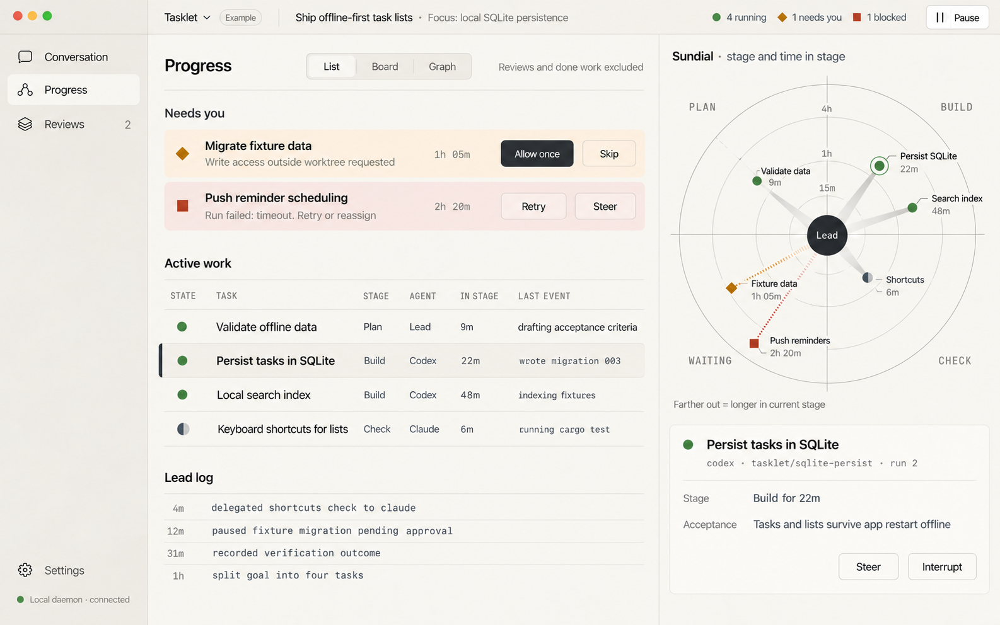
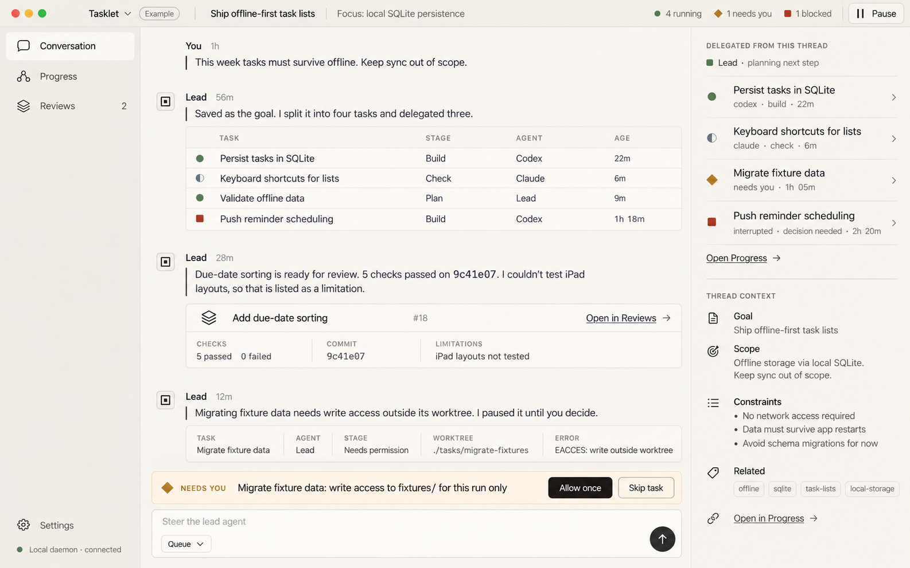
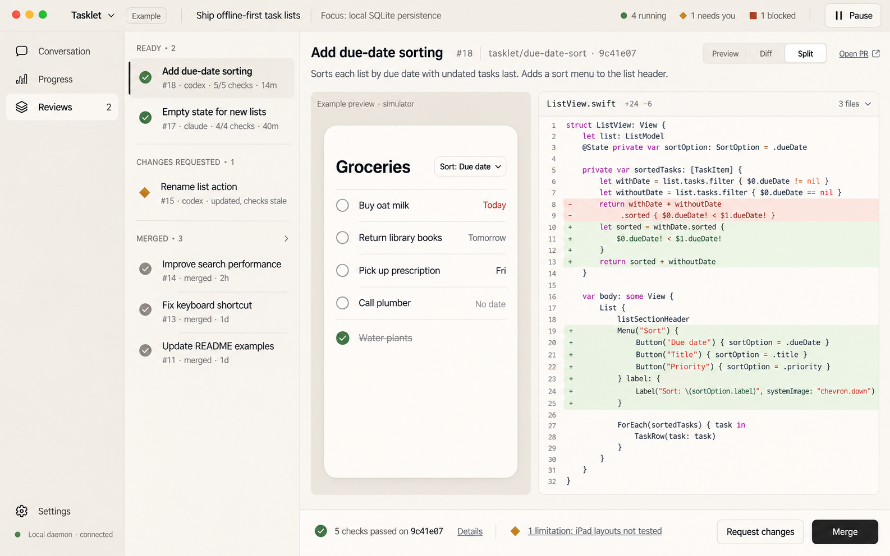

# Operating Desk redesign

Proposed on November 1, 2026. Design by Claude Opus through Cursor CLI; raster mockups rendered with built-in Image Gen. These are illustrative screens, not a working application or observed agent activity.

This pass responds to the request for fewer emoji, more compact controls, and an operations-dashboard feel. It retains separate Conversation, Progress and Reviews destinations and the warm paper palette.

- **Conversation:** a compact lead-agent work log, queued steering and a delegated-work rail.
- **Progress:** active-work rows and actionable blockers take priority; a smaller Sundial radar accompanies selected-task details.
- **Reviews:** a compact change queue, dominant preview/diff and commit-bound evidence.

No emoji are used. Small monochrome icons label functions, while state shapes accompany colours. The Tasklet project and its tasks, checks and changes are fictional examples.

## Screens

### Progress

### Conversation

### Reviews

## Design sources

- [Claude's design brief](claude-design-brief.md)
- [Request sent to Claude](request.md)
- [Cursor execution provenance](provenance.json)
- Render prompts: [Conversation](conversation-prompt.txt), [Progress](progress-prompt.txt), [Reviews](reviews-prompt.txt)
- [Previous mockups](../claude-redesign/README.md)

Render prompts adjust Claude's sample copy to keep sync work outside the example goal and remove a review reference from Progress. Raster geometry and text remain illustrative; implementation must verify sizing, accessibility, state consistency and radar positions against the design contract.

## Visual review limits

The generated layout conveys the denser operational direction. The raster does not reliably map every radar marker to its labeled age, even after a targeted correction; the table is the sample-data reference and the chart must be computed from real stage-entry times in implementation. The generated Conversation adds context items beyond the brief, and sidebar widths vary slightly across screens. These are proposals for review, not pixel-exact implementation specifications.
