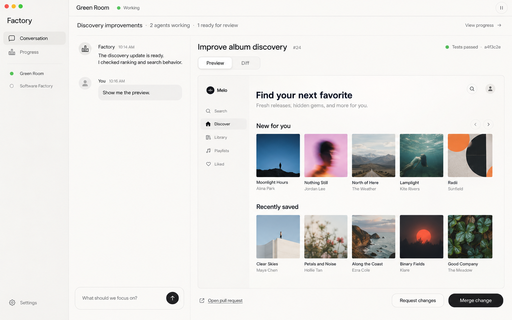
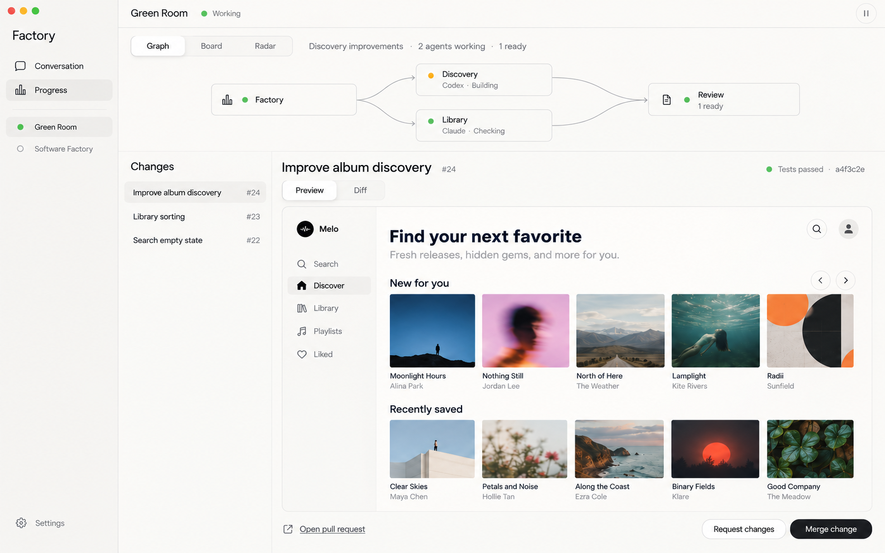
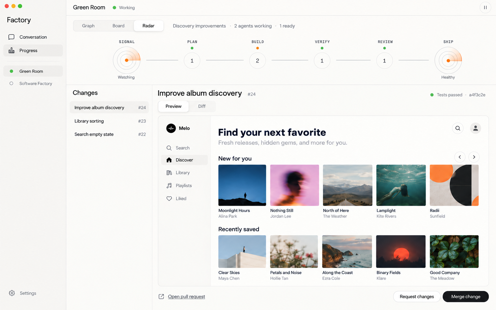

# Revised visual direction

Status: proposed design, October 31, 2026; awaiting user selection. These are illustrative screens, not runtime evidence. Numbers, agent activity, review status and deployment health in the images are sample content.

The initial concepts were rejected as too busy. The brief is explicit: only talk to one main agent; inspect progress separately; show which agents work on what through a graph or board, and offer a factory-style radar view. The latest refinement asks for more compact controls, a top-level overview, and a substantially larger review pane for each selected change. The user clarified that “the top” means the top-level overview.

## One shared interface

- **Conversation:** one lead agent, a concise current focus and a single steering input. When a change is selected, use a compact conversation column beside the larger review pane. Keep worker sessions, tools, model controls and setup out of the primary reading surface.
- **Progress:** graph, board and radar views of the same durable tasks and runs. Keep the overview in a compact strip at the top. Select a node, task or stage to inspect evidence and worker activity.
- **Review:** keep a selected review packet visible in most of the available workspace. Show the actual preview or diff, checks and review actions. Use a short changes list to select another packet.
- **Settings:** secondary factory context, provider connections, agency, schedules and operating limits.

Use warm white, pale stone and charcoal with restrained sage and amber states. Show one repository/project at a time, with a quiet project switcher. Do not expose a permanent worker-detail pane or feature inventory. Reduce chrome and repeated labels while keeping readable 14–16px text.

The latest target is a 1440×900 desktop viewport, approximately 176px sidebar, 48px top bar and 20px workspace margins. Limit the graph/radar overview to roughly 144–160px high. Below it, give the selected review the remaining height. A narrow change list and a large preview take priority over large headings, repeated goal blocks and duplicate status summaries. In Conversation, a roughly 340–360px conversation column sits beside an approximately 848px review pane. These proportions guide implementation; the generated image pixel dimensions are not a layout constraint.

Independent review of the latest mocks found one remaining content adjustment: use the existing overview line for a concise factory goal and current focus, rather than only the current task category. Disclose the full saved goal from that line; do not add another panel. The compact hierarchy and larger review area otherwise match the clarified request.

## Screens

The earlier `conversation.png`, `progress-graph.png` and `progress-radar.png` are superseded explorations. The music application shown inside these previews is illustrative sample content, not a verified Green Room build or deployment.

Graph edges must express actual delegation or dependencies. The radar is a signal-to-shipping pipeline, inspired by the user's factory reference, rather than an arbitrary quality score. Counts and deployment health must come from observations; show unknown or empty states when there is no evidence.

The TUI shares the same destinations, commands, task ownership and evidence. Terminal-friendly lines, lists and stage counts can communicate the same relationships without imitating desktop pixels.

Generated with the built-in Image Gen tool using the supplied Codex, Ramp and factory references, then the earlier refined screens. Latest prompts emphasized compact chrome, a top-level overview strip, one lead conversation and a large preview/diff review pane, with no additional dashboard panels.
