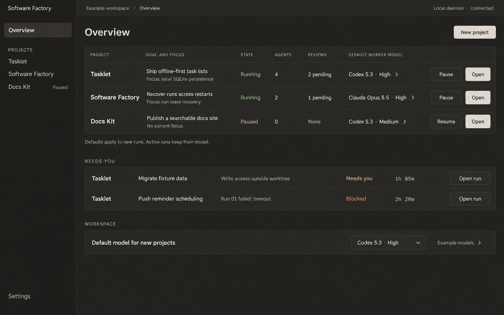
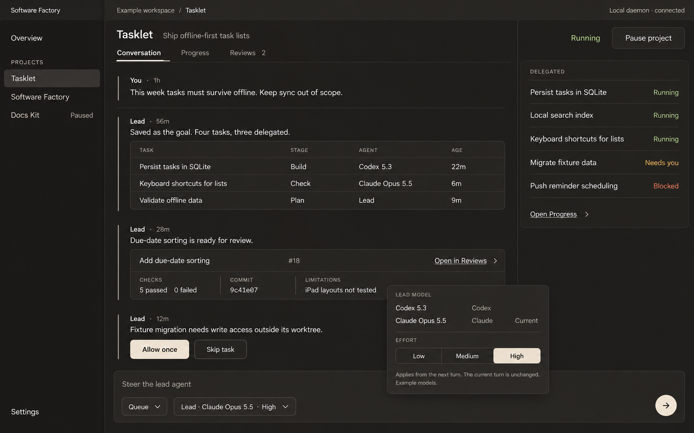
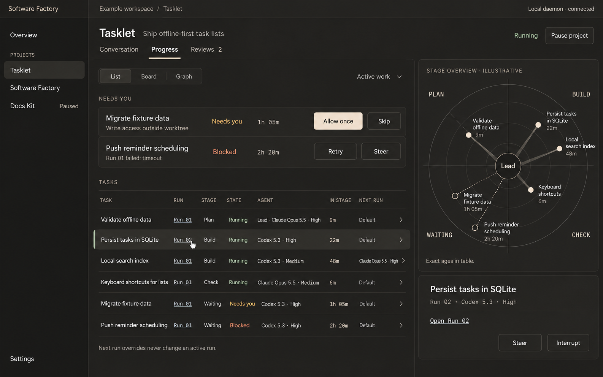
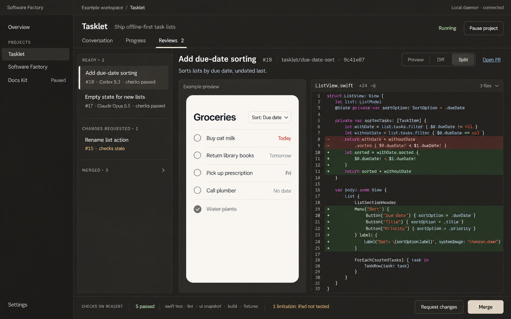
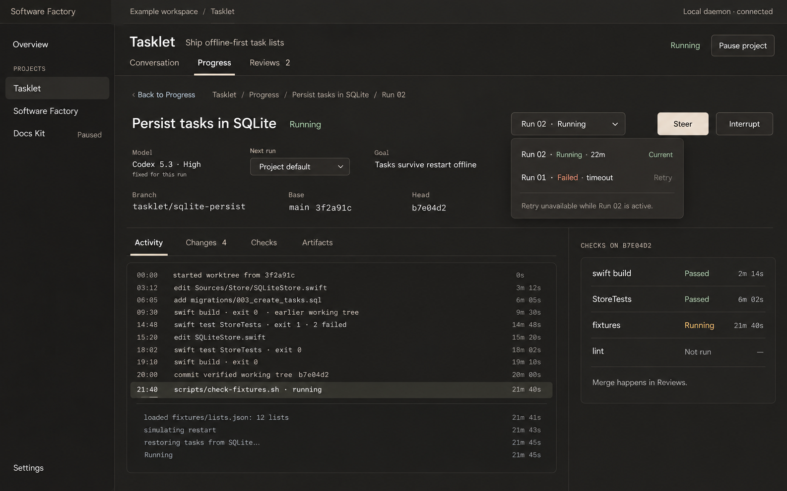

# Soft Charcoal

Proposed November 1, 2026. Design by Claude Opus through Cursor CLI; mockups rendered with built-in Image Gen. This pass softens the existing charcoal UI and adds the requested run drilldown. It is a visual proposal, not a working application.

## Visual refinement

Lifted warm charcoal replaces the near-black canvas. Warm off-white text, stone primary buttons, tonal secondary buttons, quiet separators and modest rounding reduce the harshness without changing the compact operating layout. Navigation stays text-first with no emoji. Workspace Overview and each project's Conversation / Progress / Reviews retain their roles, including scoped model and effort pickers.

## Opening runs

Progress exposes explicit run links and an Open Run action in the selected task. Workspace items needing attention also link to the relevant project's run. A task/run row or radar mark should resolve to the same project-scoped run detail; selecting historical attempts must not silently switch the project or task.

Run detail remains within the project's Progress destination. It shows the task and attempt, actual provider/model/effort, branch and commit evidence when available, timestamped tool activity, and Activity / Changes / Checks / Artifacts tabs. The attempt selector exposes failed and current attempts separately.

- Running attempts offer Steer and Interrupt. A next-run override never changes an active run's recorded configuration.
- Retry applies to terminal failed/interrupted attempts and is disabled if another attempt for the task is active.
- Previous attempts remain inspectable. Their logs, evidence and terminal outcomes stay bound to that attempt.
- Checks distinguish running, passed, failed, stale and not run. Artifacts and checks must be associated with the tested commit, not inferred from agent text.
- Review queues and merge controls stay in Reviews. Run activity contains tool calls and output, not hidden model reasoning.

## Screens

### Workspace overview

### Project conversation

### Project progress and run links

### Project reviews

### Run detail and attempt history

## Sources and limits

- [Claude's brief](claude-design-brief.md), [request](request.md), and [execution provenance](provenance.json)
- Rendering prompts: [Overview](overview-prompt.txt), [Conversation](conversation-prompt.txt), [Progress](progress-prompt.txt), [Reviews](reviews-prompt.txt), [Run detail](run-detail-prompt.txt)
- [Previous Charcoal Desk screens](../charcoal-desk/README.md)

The render prompts keep the existing plain wordmark and ensure the example run repeats its build after code changes before associating verification with its head commit. All projects, model names, runs and results shown are illustrative. Raster text and dimensions remain proposals; the eventual UI must compute chart positions and verify contrast, reflow, keyboard access and evidence freshness.
