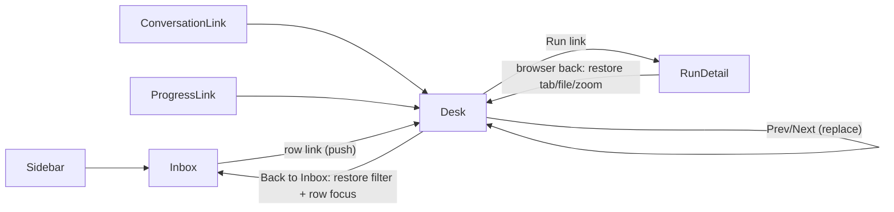

# Reviews overhaul: separate inbox and review desk

## Recommendation: Shape A

**Choose A.** `#/reviews` becomes a quiet, full-width review inbox. Selecting a row opens `#/reviews/RV-24`, a full-width review desk with Back to Inbox and Previous/Next. There is no persistent queue.

- **Why A over B.** A keeps the overview (what needs attention, status, evidence at a glance) separate from focused inspection. It gives every review a real, stable URL. It also matches the existing Runs pattern in [apps/desktop/src/Runs.jsx](../../../apps/desktop/src/Runs.jsx), which already has an index, a detail view, `Back to Runs`, and `returnFocus`. `parseHash` in [apps/desktop/src/App.jsx](../../../apps/desktop/src/App.jsx) already turns `#/reviews/RV-24` into `route.id`.
- **What B gets right, and why it loses.** B saves one click. But its picker hides the overview, puts navigation inside the work surface, and makes the default selection arbitrary (today it is hard-coded to `reviewSel = "RV-24"`).
- **Cost of A.** One extra click. This is offset by direct links from Conversation and Progress straight to the desk, plus Previous/Next on the desk.

## What is wrong today (from the evidence)

- `.reviews` spends a 208px column on a persistent queue, and the default mode is `split`, which gives the preview `minmax(260px, 34%)`.
- `.shot img` is height-locked (`height: 100%`) with a 14px rounded frame, so the 1206×2622 capture renders as a small phone thumbnail.
- The revision and run are repeated in four places: the header side, the figcaption, the footer, and the checks dialog.
- Checks and the limitation are hidden in dialogs.
- The change-request draft is lost when its dialog closes.
- `reviewStatus` and `reviewNotes` are not saved to the local store, so local outcomes disappear on reload.

## Inbox (`#/reviews`)

- **Header row (44px).** "Reviews" (16px/600), then filter tabs using the existing `Tabs` component: Needs review (count), Changes requested (count), Merged (count), All. The default filter is Needs review.
- **Rows.** Each row is an `<a href="#/reviews/RV-24">` and the list has no card chrome. Rows are 44px tall with a single separator between them.
  - Columns from left: state dot and label, `#24` plus title (flexible), evidence ("6/6 checks · 1 limitation"), screenshot ("Screenshot" or "No screenshot"), run identity ("R-3B7T · Attempt 1"), updated time.
- **Merged filter.** Reviews merged locally are real rows. The historical `MERGED` strings appear as non-link rows labeled "Earlier · not in this preview".
- **Empty states.**
  - Empty inbox: "Nothing needs review. Merged reviews stay under Merged."
  - Empty filter: "No reviews with changes requested", with a Show all button.
- **Unknown id.** Use the Runs pattern: "Review RV-99 isn't in this preview" with a Back to Inbox button.

## Desk (`#/reviews/:id`)

The desk is stacked top to bottom:

- **Desk bar (44px).**
  - `← Inbox`
  - Title (16/600) with `#24` muted
  - Status chip: Ready / Changes requested / Merged locally
  - Run scope "R-3B7T · Attempt 1" as a link to `#/runs/R-3B7T`, with "(latest)" or "Attempt 2 is newer"
  - Right side: `‹ 2 of 3 ›`
  - Each fact appears here once. The revision is not shown in the bar; it lives in the footer evidence summary, so nothing repeats.
- **Mode bar (36px).** Preview / Changes / Evidence tabs on the left; controls for the current mode on the right.
- **Conditional callout (32px).** Shown only for a change request ("Changes requested locally: ... · waiting for a new revision") or when a newer attempt has superseded the review.
- **Stage.** Fills the remaining height. Only the stage scrolls.
- **Fixed footer (52px).**
  - Left: evidence summary, e.g. "6/6 checks passed on `a4f3c2e` · 1 limitation · Evidence". The summary is a button that switches to the Evidence tab; it does not open a dialog.
  - Right: "Local preview" note, Request changes, and Simulate merge (primary).

**Removed:** the queue column, the narrow-screen queue select, Split mode, the figcaption, the checks and limitation dialogs, `.rh-side`, and the summary paragraph in the header. The summary moves to the inbox row title tooltip and to the top of Evidence.

### Controls per mode (minimum set)

- **Preview**
  - Fit / 100% toggle (buttons with `aria-pressed`).
  - Artifact select, shown only when the run has more than one screenshot artifact. For RV-24 the options would be:
    - Collection: current
    - Accessibility size: not captured, disabled
    - Before: older revision `7d21e0b`
- **Changes**
  - File select, which appears only in this mode. Options show filename, muted directory, and +/− per file.
  - "+18 −11 · 3 files" next to the select.
  - The diff scroller stays focusable.
- **Evidence:** no toolbar controls.

### Screenshot zoom

- **No decorative frame.** Remove the 14px radius frame. Use a 1px separator and the paper `--inset` stage.
- **100% (default).** One CSS pixel per device point: 402px for the 1206px-wide @3x capture. Centered, scrolling vertically, capped at the stage width.
  - Add `scale: 3` (or a point width) to the preview fixture rather than guessing it.
- **Fit.** The whole capture fits inside the stage height.
- **Image source.** Take the image from the run's screenshot artifact whose `state: "current"` and whose revision matches `run.revision`. Fall back to `review.preview`.
- **Older-revision screenshots.** Never show one as the default preview. Only show it after an explicit choice, with a persistent "Older revision `7d21e0b`, not this review" label.

### Evidence tab

Single column, at most 760px wide, left-aligned. Sections in order:

1. **Summary:** what changed.
2. **Revision binding:** Review #24 → Run R-3B7T → Attempt 1 of 1 (latest) → revision `a4f3c2e`, plus the captured model snapshot.
3. **Checks table:** name, result, revision, observed time. Rows whose revision differs from the run's are labeled "Older revision, not counted".
4. **Artifacts:** each with its state (current / missing / stale / expired) and note.
5. **Limitations:** full text.

The footer evidence count includes only checks that passed on exactly `run.revision`. This is what `passed` already computes.

### Tab, file, and zoom policy

- **Defaults on first visit** to a review (row, Previous/Next, or direct link):
  - Preview if a current-revision screenshot exists, otherwise Changes.
  - First file selected.
  - Zoom at 100%.
- **Restoring.** Store `{tab, file, zoom}` in App state, keyed by review id. Revisiting the same review (Back then reopen, or returning from Run detail) restores its last state. Unvisited reviews always get the defaults.
- **Reset preview data** clears all of it.

### Entry, back, Previous/Next

- **Sidebar Reviews** always opens the inbox.
- **Conversation and Progress** link straight to the desk. The `.review-link` href becomes `#/reviews/RV-24` instead of `#/reviews`.
- **Order.** Previous/Next follow the inbox's current filtered order. A direct link with no filter context uses "All open" (Ready plus Changes requested). The position label reads e.g. "2 of 3".
- **Browser history.** Previous/Next use `location.replace`, so browser Back from any desk returns to the inbox instead of stepping through every review. Row clicks push a history entry.
- **Back to Inbox** restores the filter and focuses the originating row, using the same `returnFocus` pattern as Runs.
- **After a local action**, stay on the review and show its new state with a "Next review" affordance. Do not auto-advance.

### Local actions and states

- **Naming and copy.** Rename "Merge preview" to "Simulate merge". Keep both dialogs explicit: "No GitHub call, no comment posted, no agent dispatched."
- **Changes requested.**
  - Simulate merge is disabled, with the reason visible next to it ("Needs a new revision"), not only in `sr-only` text.
  - Request changes becomes "Edit request".
- **Superseded.** When a newer attempt exists for the same task (latest attempt by `taskId`), show the callout and disable Simulate merge. This is a proposed local rule, not provider behavior.
- **Merged locally.**
  - The review stays readable.
  - The footer reads "Merge simulated locally at 10:41 · no GitHub call".
  - Actions are hidden.
- **Draft recovery.**
  - Keep `reviewDrafts[id]` in App state. Cancel or Esc keeps the draft. Reopening shows "Draft restored" with a Discard draft option. Submitting clears it.
  - Save `reviewStatus`, `reviewNotes`, and `reviewDrafts` in the existing `STORE_KEY` payload, and clear them in `resetPreview`.

### Keyboard and accessibility

- **Focus on navigation.**
  - Entering the desk moves focus to the title (`h1`, `tabIndex=-1`).
  - Previous/Next keeps focus on the button pressed and announces "Review #23, 2 of 3" through the polite `Notice`.
- **Mode tabs** use the existing `Tabs` arrow, Home, and End handling. The `tabpanel` ids match the tabs.
- **Scrollers.** The screenshot scroller and diff scroller are focusable (`tabIndex=0`) and have `aria-label`s, so the arrow keys scroll them.
- **Shortcuts.** No single-key global shortcuts. Escape belongs to dialogs only.
- **Inbox rows** are links in normal tab order.

## Layout budgets

The sidebar is 168px at 1024 and up and becomes a drawer at 768 and below. The global header is 40px. Desktop heights assume a 900px-tall viewport.

- **1440.** Content 1272px, horizontal padding 16px, stage 1240×728.
  - Preview: 402px capture, nearly the full height visible.
  - Changes: diff 1240px wide.
  - Evidence: 760px column.
  - Inbox: all columns shown.
- **1280.** Content 1112px, stage 1080×728. Same as 1440.
- **1024.** Content 856px, stage 824×728.
  - The desk bar title truncates (full title in Evidence and the inbox).
  - The inbox drops the screenshot and updated columns.
- **768.** Full width, no sidebar.
  - The desk bar becomes two lines (64px). Row 1: back, title, status, Previous/Next. Row 2: run scope.
  - Stage about 736×832 on a 1024px-tall viewport.
  - The inbox drops the run column.
- **390.** Viewport 844px tall.
  - Desk bar 36px: `← Inbox` and `‹ 2/3 ›`.
  - Title block about 52px: title clamped to two lines, status and run scope on one line.
  - Tabs about 36px, three equal tabs.
  - Mode controls 32px: Fit/100%, or a full-width file select.
  - Stage about 568px tall. 100% caps at about 366px wide; Fit is about 254px wide.
  - Footer about 80px: summary line, then two 50/50 buttons.
  - Inbox rows 56px with two lines: title, then "#24 · Ready · 6/6 checks · 1 limitation".
  - No horizontal page scroll.

## Files to change (no new dependencies)

- [apps/desktop/src/Reviews.jsx](../../../apps/desktop/src/Reviews.jsx): split into `ReviewInbox` and `ReviewDesk`. Reuse `DiffPane`, `ChangesForm`, `Tabs`, `Dialog`, and `Notice`. Replace the checks and limitation dialogs with `EvidencePanel`.
- [apps/desktop/src/App.jsx](../../../apps/desktop/src/App.jsx):
  - Pass `route.id`.
  - Replace `reviewSel` with `reviewsUi {filter, returnFocus, byId}` and `reviewDrafts`.
  - Persist the review state.
  - Update the Conversation and Progress links.
- [apps/desktop/src/styles.css](../../../apps/desktop/src/styles.css): replace the `.reviews` and `.review-*`, `.queue-*`, `.shot`, and `mode-split` rules and their media rules with inbox and desk rules.
- [apps/desktop/src/data.js](../../../apps/desktop/src/data.js): add the preview `scale`. Optionally add one older-revision check to `R-2F9A` so the stale-check state can actually be seen.

## Acceptance checks

1. **Default Preview at 1440×900.** `#/reviews/RV-24` opens in Preview with no queue column.
   - The capture renders 402px wide with no rounded frame.
   - The stage is at least 700px tall.
   - Fit shows the whole capture.
   - The revision appears exactly once on screen (the footer summary).
2. **Default Changes without a screenshot.** `#/reviews/RV-23` opens in Changes.
   - The Preview tab says no screenshot was captured, with the run identity.
   - Evidence lists 5/5 checks bound to `71d09be`.
   - The file select exists only in Changes.
3. **Navigation and focus.** Under the Changes requested filter, open RV-22.
   - Simulate merge is disabled and the reason is visible.
   - Back to Inbox restores the filter and focuses the RV-22 row.
   - After Previous/Next, browser Back returns directly to the inbox.
4. **Draft recovery.** Type a change request, press Esc, go Next then Previous, and reopen: the draft is restored.
   - Submitting records the request locally, with a notice saying nothing was sent.
   - A reload keeps the local status.
   - Reset preview data clears it.
5. **Honest evidence and 390px layout.**
   - A check or screenshot from a revision other than `run.revision` is labeled as an older revision and excluded from the footer count.
   - A newer attempt shows the superseded callout and blocks Simulate merge.
   - At 390px there is no horizontal page scroll. The tabs, the screenshot and diff scrollers, and the footer actions are all reachable by keyboard.

## Sources inspected

- [apps/desktop/AGENTS.md](../../../apps/desktop/AGENTS.md)
- [apps/desktop/src/Reviews.jsx](../../../apps/desktop/src/Reviews.jsx)
- Review rules in [apps/desktop/src/styles.css](../../../apps/desktop/src/styles.css) (lines 2080-2372, plus the 1024 and 768 media rules)
- `REVIEWS`, `MERGED`, and the run checks and artifacts in [apps/desktop/src/data.js](../../../apps/desktop/src/data.js)
- Hash routing and review state in [apps/desktop/src/App.jsx](../../../apps/desktop/src/App.jsx)
- The index/detail pattern in [apps/desktop/src/Runs.jsx](../../../apps/desktop/src/Runs.jsx) and `Tabs`/`Dialog` in `ui.jsx`
- Skill routing guidance and the designer, workbench, and agent-flows skills

`reviews-before-1440.png` does not exist, so I used `docs/design/compact-preview/polish-screenshots/reviews-1440.png` and `reviews-390.png` as the current artifact. The pixel budgets above are calculated from the CSS, not measured in a running preview.

